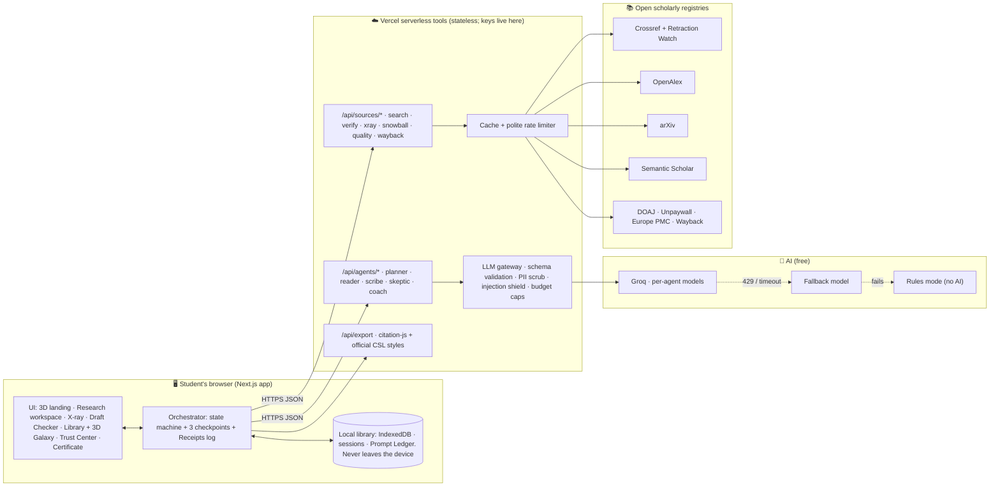

# 03 · Agents, workflow and architecture

*This is the technical blueprint Claude Code builds from, and the source for deck slides 2 (Workflow) and 3 (Architecture).*

## The one rule everything follows

> **The AI may plan, search, read and explain. Only public registries may cite. Only the student may decide.**

- Every **decision** (is this reference real? does the quote exist? which trust label?) is made by **code we can test**, not by a model.
- Models do four jobs only: **decompose** (plan), **extract** (quotes and findings), **challenge** (skeptic), **explain** (brief and coaching).
- If you remember one sentence for the judges, make it this one.

---

## 1. The agent crew: 5 pipeline agents, 3 support agents, 1 boss

| Agent | Job | Engine | Allowed to | **Not** allowed to | Output (validated schema) |
|---|---|---|---|---|---|
| 👤 **Student (Principal Investigator)** | Final authority | Human | Approve or reject plan, sources, claims; edit anything; export | (nothing is decided without them) | Decisions, logged |
| 🧭 **Planner** | Turns a question into a search plan | LLM (Groq) | Propose sub-questions, keywords, synonyms, year range, inclusion rules | Search, cite, answer the question | `Plan { subQuestions[], queries[], filters, rationale }` |
| 🔭 **Scout** | Finds candidates | Code + LLM for query expansion | Query OpenAlex, Crossref, arXiv (Semantic Scholar optional); dedupe; snowball | Invent or edit metadata | `Candidate[]` straight from registry JSON |
| 🛡️ **Verifier** | Proves each source is real | **Code only, no AI** | Resolve DOI, cross-match title/authors/year across 2 registries, check retractions, collect quality facts | Be persuaded. It has no prompt to inject | `Verification { status, fieldChecks[], retraction, quality }` |
| 📖 **Reader** | Pulls evidence out of approved sources | LLM + code check | Extract findings with **exact quote spans** from abstract or open full text | Paraphrase as a quote; use text it wasn't given | `EvidenceCard { finding, quote, location }` (quote must string-match, or it's dropped) |
| ⚖️ **Skeptic** | Attacks every claim | LLM (**different model family** from Scribe, no shared memory) + counter-search | Reject claims against named criteria; find opposing papers | Rewrite claims; approve its own suggestions | `Challenge { verdict, reasons[S1–S8], counterSourceIds[] }` |
| ✍️ **Scribe** | Drafts the evidence brief | LLM | Write sentences that cite **only IDs from the approved list** | Cite anything unapproved, give confidence percentages, write the essay | `Claim[] { text, kind: finding/reasoning, sourceIds[], quote }` |
| 🧾 **Integrity Clerk** | Paperwork of honesty | **Code** (templates) | Build the AI-use statement, Prompt Ledger, certificate, APA checks, paraphrase guard | Invent anything not in the logs | Disclosure text, ledger, certificate |
| 🎓 **Coach** (support) | Keeps the student thinking | LLM | Ask Socratic questions; prompt explain-it-back | Answer for the student | `Question[]` |
| 🐕 **Watchdog** (support) | Keeps the library honest over time | Code | Re-check saved DOIs for retractions and corrections on library open | Change the library without telling you | Alerts |

**Why this many agents is justified (judges may ask, see `08_DEMO_SCRIPT_AND_QA.md`):** each agent uses different tools or a different model, and two pairs **must not share state**. Scribe vs Skeptic is adversarial separation, and the Verifier must be immune to persuasion. We didn't split a single chatbot into costumes.

---

## 2. The workflow, step by step (Deck slide 2)

```
 STUDENT        ── Ask ──────── ✋CP1 Approve plan ───────────── ✋CP2 Approve sources ─────────────── ✋CP3 Approve claims ── Export
                     │                    ▲                               ▲                                   ▲               │
 AGENTS              ▼                    │                               │                                   │               ▼
               🧭 Planner ── plan ────────┘   🔭 Scout → 🛡️ Verifier ─────┘   📖 Reader → ✍️ Scribe → ⚖️ Skeptic ─┘     🧾 Integrity Clerk
                                                (search)   (✔ check A,B)        (✔ check C)   (✔ check D)  (✔ check E)   (disclosure, ledger,
                                                                                                                         certificate, APA)
 SOURCES                                    OpenAlex · Crossref · arXiv · Retraction Watch · DOAJ · Unpaywall/Europe PMC · Wayback
```

| # | Step | Who | Student control | Checked by |
|---|---|---|---|---|
| 1 | Student types a research question, picks the **autonomy dial** (Off / Assist / Co-pilot) and optional filters (years, peer-reviewed only, open access only) | Student | Sets the scope and how much AI helps | n/a |
| 2 | **Planner** proposes sub-questions, keywords and inclusion rules | LLM | **✋ CP1: edit and approve the plan.** Nothing is searched before this | Schema validation |
| 3 | **Scout** searches 3–4 registries in parallel, merges duplicates, optionally snowballs | Code | Can add or remove keywords and re-run | n/a |
| 4 | **Verifier** checks every candidate | Code | Sees the field-by-field table | **✔ A: registry cross-match** (DOI + title + authors + year in 2 registries). **✔ B: retraction/correction check** |
| 5 | Student reviews sources with quality facts and the bias lens | Student | **✋ CP2: accept or reject each source with a reason** | Read-before-cite tracking |
| 6 | **Reader** extracts evidence cards with exact quotes | LLM + code | Can open the source and confirm | **✔ C: quote string-match**. A quote not in the text is dropped |
| 7 | **Scribe** drafts a brief from approved evidence only | LLM | — | **✔ D: whitelist**. Any source ID not in the approved list is rejected and logged as a *blocked fabrication* |
| 8 | **Skeptic** challenges each claim, searches for counter-evidence; optional Debate mode | LLM + code | Student judges disputes | **✔ E: adversarial review** against named criteria S1–S8 |
| 9 | Labels are assigned **by code** (see §3) | Code | **✋ CP3: keep, edit or drop each claim**; write explain-it-back lines | — |
| 10 | **Integrity Clerk** exports references (APA 7 etc.), the AI-use statement, Prompt Ledger and Verification Certificate (QR) | Code | Student downloads; nothing leaves the device otherwise | Hash for tamper evidence |

**Side doors (no full session needed):** Reference X-ray (paste a bibliography), Draft Checker (paste a paragraph), Library (manage and export), Certificate (anyone can re-verify).

### Skeptic's named rejection criteria (shown to the student as reasons)

| Code | Rejects when… |
|---|---|
| S1 | The claim cites no source, or an ID that was never retrieved (auto-blocked by code) |
| S2 | The cited text does not contain the asserted fact |
| S3 | The claim overgeneralises the population, setting or sample |
| S4 | A causal claim is drawn from correlational evidence |
| S5 | The quote is altered or out of context |
| S6 | The source is retracted, or a preprint is presented as settled |
| S7 | A single source is presented as consensus |
| S8 | The source text contains instruction-like content (injection attempt). Logged as a finding |

Critic rounds are capped at 2. Rejected claims are **kept and shown** (struck through, with the reason), never silently dropped. Showing what we refused is our cheapest credibility win.

---

## 3. Trust labels: assigned by code, never by the model

**Claim labels** (what the problem statement asked for):

| Label | Rule (all deterministic) | UI |
|---|---|---|
| ✅ **Verified** | Kind = finding **and** every cited source is registry-Verified **and** the quote is found in the source text **and** Skeptic verdict = supported | Solid green check + "Verified against abstract" or "…full text" |
| 🟡 **Reported, not checked** | Source is registry-Verified **but** we can't read text that would confirm the claim (no abstract or full text available) | Amber half-circle + "Source is real; this detail wasn't checkable" |
| 🔷 **AI reasoning** | Kind = reasoning (the Scribe's own synthesis across sources), always listing which sources it reasons from | Blue diamond + "This is the AI's inference, not a source's statement" |
| ⛔ **Not found** | No reliable source found, **or** quote not in source, **or** Skeptic verdict = unsupported | Red hollow circle + receipts of what was searched |

**Reference statuses** (Verifier and X-ray):

| Status | Rule |
|---|---|
| **Verified** | Found in Crossref **and** OpenAlex (or arXiv) · title similarity ≥ 0.90 · first-author surname matches · year within ±1 · DOI (if given) resolves to *this* paper |
| **Chimera** | Its parts are real but belong to **different** papers (e.g. the title matches paper X while the authors and year match paper Y). This is SP Jain §h(ix) exactly |
| **Mismatch** | A best match exists but ≥ 1 field disagrees (wrong year, wrong journal, the DOI points elsewhere) |
| **Not found** | No candidate above threshold in any registry |
| **Retracted** | Matched, and a retraction notice exists. Overrides everything, shown in red |
| **Partial** | Books, reports or web pages without a DOI: found in one registry or as a live/archived URL only |

Similarity scores are computed by code (normalised token-set ratio for titles, surname-set overlap for authors) and unit-tested.

---

## 4. Architecture (Deck slide 3)



**Plain-English version for the slide:**
1. **Website (browser):** the student's workspace. It runs the step-by-step workflow and keeps the library **on the student's device**.
2. **Serverless tools (Vercel):** small, stateless functions. They hold the API keys and do the searching, verifying, formatting and AI calls.
3. **AI (Groq, free):** a different open model per agent. If one is busy we switch models; if AI is unavailable, **Rules mode** keeps every check working.
4. **Sources:** Crossref, OpenAlex, arXiv, Semantic Scholar, Retraction Watch, DOAJ, Unpaywall/Europe PMC, Wayback Machine. Open, licensed and free.
5. **Reference storage:** the browser's IndexedDB. Export to BibTeX, RIS or CSL-JSON (opens in Zotero/Mendeley). Certificates carry their data **inside the link**, so no server stores student data.

**Why the orchestrator runs in the browser:** checkpoints wait for a human, which can take minutes, and serverless functions time out. Running the state machine client-side also keeps the student's work private, and each server call stays short and stateless.

---

## 5. Tech stack (versions as of 24 Nov 2026; already scaffolded in `veracite/`)

| Layer | Choice | Why |
|---|---|---|
| Framework | **Next.js 16.4** (App Router) · **React 19.3** · TypeScript | Already scaffolded. Free on Vercel. API routes and UI in one repo |
| Styling | **Tailwind CSS 4.3** + CSS variables for both themes | Fast; tokens per theme |
| Motion | **Motion 12** (`motion/react`) · Lenis (landing only) | Smooth, accessible animation |
| 3D | **three.js + @react-three/fiber + @react-three/drei** (+ postprocessing); **react-force-graph-3d** for the Galaxy | Industry-standard web 3D |
| Theme | **next-themes** | Light/dark without flash |
| State / storage | **Zustand** (+ persist) · **Dexie** (IndexedDB) | Local-first library |
| Validation | **zod** | Every agent output validated against a schema |
| AI | **Vercel AI SDK v7** (`ai` + `@ai-sdk/groq`), `generateText({ output: Output.object({ schema }) })`. Note: `generateObject` is deprecated in v7 | Structured output, retries, provider swap |
| Citations | **citation-js** (`@citation-js/core`, `plugin-csl`, `plugin-bibtex`, `plugin-ris`) + official **CSL** styles (APA 7, MLA 9, Harvard, IEEE, Chicago) | Same style files Zotero/Mendeley use |
| Matching | Custom normalisers + token-set ratio / Jaro-Winkler (unit-tested) | Deterministic verification |
| Charts | Recharts or visx (themed) | Bias lens |
| Utilities | `cmdk` (⌘K) · `sonner` (toasts) · `lucide-react` · `qrcode` · `lz-string` (certificate in URL) · `pdfjs-dist` (PDF drop) | Small, proven |
| i18n | Simple dictionary + `dir="rtl"`, Arabic font (IBM Plex Sans Arabic) | Arabic/English |
| Tests | Vitest (verifier unit tests + golden set) | Proof for the Trust Center |
| Hosting | **Vercel Hobby (free)** + private GitHub repo | Live link for judging |

### Models (Groq free tier: limits are *per model*, so we spread agents across models)

| Agent | Suggested Groq model (confirm IDs at console.groq.com/docs/models on build day) | Why |
|---|---|---|
| Planner | `llama-3.3-70b-versatile` (or newest Llama) | Reliable structured plans |
| Reader | `openai/gpt-oss-20b` | Fast, cheap extraction |
| Scribe | `openai/gpt-oss-120b` | Strongest reasoning for synthesis |
| Skeptic | newest **Qwen** model on Groq | **Different model family** from Scribe, so errors don't correlate |
| Coach | `llama-3.1-8b-instant` | Cheap and fast |

Model IDs live in environment variables, so switching models is a config change, not a code change.

**Budget maths:** one full research session ≈ 5–7 AI calls (≈ 15–25K tokens). Free-tier capacity spread across 4–5 models covers dozens of sessions a day. The X-ray and the Verifier use **zero** AI calls.

### Environment variables / accounts to create today

| Variable | Where to get it | Who |
|---|---|---|
| `GROQ_API_KEY` | console.groq.com (free) | K |
| `OPENALEX_API_KEY` | openalex.org account → API key (free, mandatory since Feb 2026) | K |
| `CROSSREF_MAILTO` | Any team email (puts us in Crossref's polite pool) | K |
| `S2_API_KEY` (optional) | semanticscholar.org/product/api (approval can take time, **apply today**) | Z |
| `UNPAYWALL_EMAIL` | Any team email | K |
| `MODEL_PLANNER`, `MODEL_READER`, `MODEL_SCRIBE`, `MODEL_SKEPTIC`, `MODEL_COACH` | From the Groq models page | K |
| Vercel account + private GitHub repo | vercel.com (Hobby), github.com | K (Z and A as collaborators) |

---

## 6. API routes (server tools)

| Route | Does | AI? |
|---|---|---|
| `POST /api/agents/planner` | Question → Plan | ✅ |
| `POST /api/agents/reader` | Approved sources + text → EvidenceCards (quotes checked) | ✅ |
| `POST /api/agents/scribe` | EvidenceCards + whitelist → Claims | ✅ |
| `POST /api/agents/skeptic` | Claims + sources → Challenges (+ counter-search) | ✅ |
| `POST /api/agents/coach` | Context → Socratic questions | ✅ |
| `POST /api/sources/search` | Queries → merged Candidates | ❌ |
| `POST /api/sources/verify` | Candidate(s) → Verification | ❌ |
| `POST /api/sources/xray` | Raw bibliography text → per-reference verdicts | ❌ |
| `POST /api/sources/snowball` | DOI → references / citing works (verified) | ❌ |
| `GET /api/sources/wayback?url=` | Archive availability + Save link | ❌ |
| `POST /api/export` | CSL-JSON + style → formatted bibliography, BibTeX, RIS | ❌ |
| `GET /api/v1/verify?doi=` | Public verifier (first step to an MCP server) | ❌ |
| `GET /api/health` | Which providers are up; quota used | ❌ |

## 7. Core data types (sketch)

```ts
type Status = 'verified' | 'chimera' | 'mismatch' | 'not_found' | 'retracted' | 'partial';
type Label  = 'verified' | 'reported' | 'ai_reasoning' | 'not_found';

interface SourceRecord {
  id: string; doi?: string; title: string; authors: { family: string; given?: string }[];
  year?: number; venue?: string; type: 'article' | 'preprint' | 'book' | 'chapter' | 'report' | 'web';
  abstract?: string; textAvailable: 'full' | 'abstract' | 'none';
  verification: { status: Status; checks: FieldCheck[]; registries: string[]; checkedAt: string };
  quality: { peerReviewed?: boolean; inDOAJ?: boolean; citedBy?: number; openAccess?: boolean; countries?: string[] };
  retraction?: { kind: 'retraction' | 'correction' | 'concern'; date: string; source: 'publisher' | 'retraction-watch' };
  url?: string; archivedUrl?: string; tags: string[]; collections: string[]; notes: string;
  opened: boolean; explainBack?: string; sample?: boolean;           // sample → SAMPLE ribbon (rule 9)
}
interface FieldCheck { field: 'doi' | 'title' | 'authors' | 'year' | 'venue'; claimed?: string; found?: string; match: 'exact' | 'close' | 'different' | 'missing' }
interface Claim { id: string; text: string; kind: 'finding' | 'reasoning'; sourceIds: string[]; quote?: string;
  quoteFound?: boolean; skeptic?: { verdict: 'supported' | 'partial' | 'unsupported'; reasons: string[]; counterSourceIds: string[] };
  label: Label; decision: 'pending' | 'kept' | 'edited' | 'dropped' }
interface Receipt { at: string; actor: string; action: string; input: string; output: string; model?: string; tokens?: number; ms: number; ok: boolean }
```

## 8. Folder structure Claude Code will create

```
veracite/
  src/app/page.tsx                    ← 3D landing
  src/app/research/page.tsx           ← agent workspace + Mission Control
  src/app/xray/page.tsx               ← Reference X-ray
  src/app/draft/page.tsx              ← Draft Checker
  src/app/library/page.tsx            ← library + bias lens + 3D Galaxy
  src/app/trust/page.tsx              ← Trust Center (governance)
  src/app/certificate/page.tsx        ← re-verifiable certificate
  src/app/api/agents/[agent]/route.ts
  src/app/api/sources/*/route.ts
  src/lib/verify/        ← deterministic core: match.ts, labels.ts, retraction.ts, quote.ts  (100 % unit-tested)
  src/lib/registries/    ← crossref.ts, openalex.ts, arxiv.ts, s2.ts, doaj.ts, wayback.ts, unpaywall.ts
  src/lib/agents/        ← planner.ts, reader.ts, scribe.ts, skeptic.ts, coach.ts (prompt + zod schema each)
  src/lib/llm/           ← gateway.ts (fallback chain, budget, PII scrub, injection shield), ledger.ts
  src/lib/cite/          ← csl.ts + styles/*.csl
  src/lib/store/         ← library.ts, session.ts, receipts.ts
  src/components/        ← three/, agents/, trust/, ui/
  tests/golden/          ← real, fabricated, chimera, retracted reference sets (all labelled SAMPLE)
```

## 9. Failure handling (how the demo survives anything)

| Failure | What happens |
|---|---|
| Groq 429 or timeout | Retry once, then the next model, then Rules mode. A banner says so honestly |
| A registry is down | The other registries are still used. A source verified by only one registry shows **Partial**, never Verified |
| LLM returns invalid JSON | One repair attempt; then the step fails visibly and the student can retry. No silent guessing |
| LLM cites an unknown ID | Blocked automatically. Counted as a "blocked fabrication" in Receipts (a great demo moment) |
| Venue Wi-Fi dies | Pre-recorded 90-second backup video + **cached demo session** (labelled SAMPLE) that replays from local data |
| Rate limit during judging | Responses cached for 24 h; the demo questions are pre-warmed 30 minutes before |

## 10. Tests and evals (Zedan owns, results go on the Trust Center and deck slide 6)

**Golden set** (`tests/golden/`, every item labelled `sample: true`):
- 30 real references across disciplines (include business, management, AI and health)
- 20 fully fabricated references generated by ChatGPT/Gemini (kept unedited, labelled **FABRICATED FOR TESTING**)
- 10 chimeras (real title + wrong authors/year)
- 5 known-retracted papers
- 5 web sources

**Metrics we publish (honestly, with the date):**
- Fabricated references caught (target 100 %)
- **Fakes wrongly marked Verified** (target **0**. This is the number that matters most)
- Real references verified (target ≥ 90 %; books without DOIs may show Partial)
- Median X-ray time per reference (target < 2 s)
- Claim-label agreement with our hand labels on 20 claims

**Unit tests:** title normaliser, author matcher, year rule, chimera detector, quote matcher, label rules. These are the deterministic core, so every decision path is covered.
